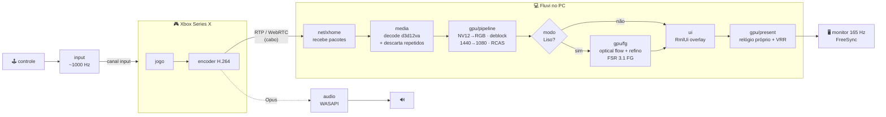

<div align="center">

# 🌊 Fluvi

**Remote Play do Xbox Series X no PC, nativo, leve e mais bonito que o original.**

Stream em 1440p, limpeza e nitidez na GPU, frame generation e input lag baixo,<br>
num app de ~100 MB em C++20 e Direct3D 12. Sem Electron e sem navegador no meio.


</div>

---

## O que é

O Fluvi conecta no **seu** Xbox de casa (Remote Play / xHome, **não** é xCloud) e mostra o jogo no PC. Ele melhora
o que o app oficial e os clientes abertos entregam:

| | App oficial | XStreaming / Greenlight | Veyra | **Fluvi** |
|---|---|---|---|---|
| Resolução do stream | até 1440p | até 1080p | 1080p fixo | **1440p** (reduzido pra 1080p no seu monitor) |
| Bitrate configurável | ❌ | ✅ | ❌ | ✅ |
| Limpeza de compressão + nitidez | ❌ | ❌ | ✅ | ✅ |
| Frame generation (30→60) | ❌ | ❌ | ✅ (sem descartar frames repetidos no Xbox) | ✅ **com** descarte |
| Pronto pro Lossless Scaling | ❌ | ❌ | ❌ | ✅ opção "só frames novos" |
| Controle enviado na hora | ? | a cada 16 ms | ✅ | ✅ ~1000 Hz |
| Tamanho | loja | ~150 MB (Electron) | ~1,5 GB | **~100 MB** |

## Os modos

Um jogo travado em 30 fps (GTA 6) chega no stream a 60 Hz, com **cada frame repetido**. O Fluvi sabe disso:

| Modo | Pra quê | Lag extra |
|---|---|---|
| 🎮 **Jogar** | o menor lag possível, com toda a melhoria de imagem | ~0 |
| 🎮 **Jogar** + *"Mostrar só frames novos"* | entregar 30 frames reais e limpos pro **Lossless Scaling** gerar os 60 | o do Lossless |
| 🌊 **Liso** | FG próprio de 30→60, com refino de movimento e HUD travado | ~36–41 ms |

Troca de modo por tecla, no meio do jogo.

> **Por que o FG sempre soma lag?** Pra inventar o frame do meio, é preciso **esperar o próximo frame real**
> (33 ms num jogo de 30). Isso vale pra qualquer FG por interpolação: Lossless, AFMF, Veyra, Fluvi.

---

## Como funciona

### O caminho de um frame



### As ideias que fazem diferença

- **🗑️ Fila que joga fora o velho** (`LatestQueue`): se alguma etapa atrasar, o frame antigo é descartado e
  nunca acumula. Atraso não vira fila.
- **⏱️ Relógio próprio de apresentação** (`PresentClock`): o app decide o instante exato de mostrar cada frame,
  real ou gerado, com espaçamento igual e FreeSync. É o segredo de fluidez herdado do Veyra.
- **🔁 Descarte de frames repetidos:** num jogo de 30, metade do stream é cópia. O FG nunca interpola entre dois
  frames iguais.
- **🧭 Movimento de qualidade sem dados do jogo:** vídeo não tem vetores de movimento da engine, então o optical
  flow estima o movimento e os shaders `Flow*` corrigem as bordas e o fundo que aparece atrás dos objetos (tira a
  "gelatina").
- **📐 1440p num monitor 1080p:** pedir mais resolução e reduzir no PC (supersampling) deixa a imagem mais nítida
  e dilui os blocos de compressão.
- **🖥️ Independent Flip + VRR:** a imagem vai direto pro monitor, sem passar pela composição do Windows, e o
  overlay mostra se isso está acontecendo.

---

## Estrutura

```
fluvi/
├─ PLANO.md                 📘 plano completo (fonte da verdade)
├─ README.md                📄 este arquivo
├─ CMakeLists.txt           🔧 como montar o projeto
├─ CMakePresets.json           presets debug/release (Ninja + MSVC + vcpkg)
├─ vcpkg.json               📦 bibliotecas de terceiros
├─ cmake/Fluvi.cmake           regras comuns (avisos, flags)
├─ scripts/
│   ├─ dev.cmd                 abre o ambiente do compilador e roda um comando
│   └─ fetch-deps.ps1          baixa o AMD FidelityFX SDK 2.4
│
├─ include/fluvi/           📜 CONTRATOS: o que cada módulo oferece
│   ├─ core/                   log, relógio, Status, LatestQueue
│   ├─ common/                 Gamepad, Settings, Stats
│   ├─ gpu/                    Device, Texture, SwapChain, PresentClock, Passes, FlowPasses
│   ├─ xhome/                  Account, StreamApi, WebRtcSession, Protocol, Sdp, StreamConfig...
│   ├─ input/                  GamepadReader
│   ├─ audio/                  OpusPlayer
│   └─ ui/                     Ui
│
├─ src/                     ⚙️ IMPLEMENTAÇÃO
│   ├─ app/                    ponto de entrada (main.cpp): junta tudo
│   ├─ core/                   log e tempo
│   ├─ net/xhome/              login, consoles, sessão, WebRTC, controle binário (+ CLI de teste)
│   ├─ gpu/
│   │   ├─ core/               placa de vídeo, filas, memória, DRED
│   │   ├─ present/            swapchain, relógio, refresh/VRR, detector de Independent Flip
│   │   └─ pipeline/           motor de compute shaders e passes de imagem/movimento
│   ├─ input/                  GameInput + XInput, vibração, medidor de taxa
│   ├─ audio/                  Opus, buffer anti-picote, correção de deriva, WASAPI
│   └─ ui/                     RmlUi no D3D12 (vidro fosco sobre o jogo), QR do login
│
├─ shaders/                 🎨 programas da GPU (HLSL)
│   ├─ Nv12ToRgb · Deblock · Downscale · FsrEasu · FsrRcas      ← qualidade
│   └─ FlowAdapt/Refine/Claim/Fill · VfgShotChange · HudLock*   ← frame generation
│
├─ assets/ui/               🖌️ INTERFACE (HTML/CSS do RmlUi)
│   ├─ theme.rcss              cores, botões, sombras, animações
│   ├─ signin · consoles · connecting · stream · settings .rml
│   └─ fonts/                  Inter
│
├─ tests/                   ✅ testes por módulo (doctest) + bench de shaders
└─ third_party/
    ├─ veyra-import/           código do Veyra reaproveitado (referência)
    ├─ rmlui-backends/         originais do RmlUi
    └─ fidelityfx/             AMD FidelityFX SDK 2.4 (baixado, fora do git)
```

### O que é cada coisa

| Arquivo / pasta | Explicação curta |
|---|---|
| `.h` em `include/` | a **vitrine**: diz o que um módulo oferece, sem dizer como |
| `.cpp` em `src/` | a **cozinha**: o código que faz de verdade |
| `.hlsl` em `shaders/` | programa que roda **na GPU**, em milhares de pixels ao mesmo tempo |
| `.rml` / `.rcss` | as telas e o estilo, quase HTML/CSS. Mudam sem recompilar |
| `PROGRESSO.md` em cada módulo | o diário do agente que construiu aquela parte: feito, faltando, próximo passo |

---

## Stack

| Peça | Escolha |
|---|---|
| Linguagem | C++20 (MSVC 14.44) |
| Build | CMake + Ninja + vcpkg (`x64-windows-static-md`) |
| Gráficos | Direct3D 12, swapchain flip-model, waitable, tearing, VRR |
| Rede | libdatachannel (WebRTC) |
| Vídeo | FFmpeg d3d12va (decode direto na GPU) |
| Áudio | libopus + WASAPI low-latency |
| Controle | GameInput, com XInput de reserva |
| Interface | RmlUi 6.3 (HTML/CSS em D3D12) + Dear ImGui só no debug |
| Qualidade | Lanczos 1440→1080, deblock, RCAS; FSR 4.1.2 pro caso 720p |
| Frame generation | optical flow FidelityFX + refino `Flow*` + FSR 3.1 FG em contexto independente |

---

## Como compilar

Pré-requisitos (já estão nesta máquina): **VS Build Tools 2022** com C++, Windows SDK 10.0.26100, e o CMake, o
Ninja e o vcpkg que vêm com o VS.

```powershell
# 1. baixa o SDK da AMD (fica fora do git)
pwsh scripts/fetch-deps.ps1

# 2. configura (o vcpkg instala as bibliotecas na primeira vez)
scripts\dev.cmd cmake --preset debug

# 3. compila
scripts\dev.cmd cmake --build build\debug

# 4. roda os testes
scripts\dev.cmd ctest --preset debug
```

Pra compilar só um módulo: `-DFLUVI_MODULES=gpu` (ou `xhome`, `pipeline`, `input`, `audio`, `ui`).

Programas de teste avulsos:

| Programa | O que faz |
|---|---|
| `fluvi_gpu_demo` | abre uma janela, testa o relógio e mostra no log se tem VRR e Independent Flip |
| `fluvi_xhome_cli` | login, lista de consoles, ligar console, sem interface |
| `fluvi_pad_probe` | mostra o controle e a taxa de leitura |
| `fluvi_pipeline_bench` | mede quantos ms cada shader gasta na sua GPU |

---

## Como está sendo construído

O projeto é construído em **ondas**: vários agentes de IA trabalham em paralelo, cada um dono das suas pastas e
seguindo os contratos de `include/fluvi/`. Ao fim de cada onda, a sessão principal integra, compila e testa.

| Onda | Entrega | Estado |
|---|---|---|
| **0** | base, contratos, núcleo, import do Veyra | ✅ feita |
| **1** | GPU e tela, protocolo Xbox, interface, controle e áudio, shaders | 🟠 pela metade |
| **2** | WebRTC + decode, cadeia de qualidade, opção pro Lossless, interface com dados reais → **primeiro stream** | ⏳ |
| **3** | modo Liso (FG), medição de latência, acabamento e zip portable | ⏳ |

Onde a onda 1 parou:

| Módulo | Estado |
|---|---|
| `gpu` (core + present) | ✅ compila, testes passam na RX 6600 |
| `xhome` | ✅ compila, 15/16 testes passam |
| `input` | ✅ compila, testes passam (falta testar com controle real) |
| `audio` | ⚠️ compila, correção de deriva com sinal trocado |
| `pipeline` (shaders) | ⚠️ shaders compilam, módulo e testes ainda não montados |
| `ui` | ⚠️ telas e renderizador escritos, falta a ligação com o C++ |

Detalhes em cada `src/**/PROGRESSO.md` e no [PLANO.md](PLANO.md).

---

## Créditos e licença

Fluvi é **GPL-3.0-only**. Ele reaproveita e agradece:

- **[Veyra](https://github.com/Likely7/Veyra-NRVideo)** (GPL-3.0): protocolo xHome, FSR FG em contexto
  independente, shaders de refino de movimento, trava de HUD e descarte de repetidos.
- **[Greenlight](https://github.com/unknownskl/greenlight)** (MIT): mensagens de 1440p (PR #1752) e bitrate.
- **[AMD FidelityFX SDK](https://github.com/GPUOpen-LibrariesAndSDKs/FidelityFX-SDK)**: FSR 1, FSR 3.1/4.1 e optical flow.
- **[RmlUi](https://github.com/mikke89/RmlUi)** (MIT), **[libdatachannel](https://github.com/paullouisageneau/libdatachannel)** (MPL-2.0),
  **Opus** (BSD), **FFmpeg** (LGPL/GPL), **Inter** (OFL).

> ⚠️ Projeto pessoal, sem relação com a Microsoft. Usa os mesmos serviços de Remote Play dos clientes abertos; a
> Microsoft pode mudar ou bloquear isso a qualquer momento.
