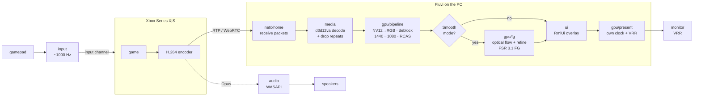

<div align="center">

# Fluvi

**A native, lightweight Xbox Remote Play client for Windows, with a better picture than the official app.**

1440p streaming, GPU cleanup and sharpening, frame generation and low input lag,<br>
in a ~100 MB C++20 / Direct3D 12 app. No Electron, no browser in the middle.


</div>

---

## What it is

Fluvi connects to **your own** Xbox at home (Remote Play / xHome, **not** xCloud) and plays it on your PC. It improves
on what the official app and the open clients deliver:

| | Official app | XStreaming / Greenlight | Veyra | **Fluvi** |
|---|---|---|---|---|
| Stream resolution | up to 1440p | up to 1080p | 1080p | **1440p** (downscaled to your monitor) |
| Configurable bitrate | ❌ | ✅ | ❌ | ✅ |
| Compression cleanup + sharpening | ❌ | ❌ | ✅ | ✅ |
| Frame generation (30→60) | ❌ | ❌ | ✅ (no duplicate-frame removal) | ✅ **with** removal |
| Ready for Lossless Scaling | ❌ | ❌ | ❌ | ✅ "new frames only" option |
| Input sent immediately | ? | every 16 ms | ✅ | ✅ ~1000 Hz |
| Size | Store app | ~150 MB (Electron) | ~1.5 GB | **~100 MB** |

## Modes

A game locked to 30 fps arrives in the stream at 60 Hz with **every frame repeated**. Fluvi knows that:

| Mode | For | Extra lag |
|---|---|---|
| **Play** | the lowest lag, with every image improvement | ~0 |
| **Play** + *"new frames only"* | hand 30 real, clean frames to **Lossless Scaling** to generate 60 | Lossless's own |
| **Smooth** | built-in 30→60 FG with motion refinement and HUD lock | ~36–41 ms |

Switch modes with a hotkey, mid-game.

> **Why does FG always add lag?** To invent the frame in between, you must **wait for the next real frame** (33 ms in
> a 30 fps game). That holds for any interpolating FG: Lossless, AFMF, Veyra, Fluvi.

---

## How it works

### The path of a frame



### The ideas that matter

- **A queue that drops the old** (`LatestQueue`): if a stage falls behind, the stale frame is discarded instead of
  piling up. Delay never becomes a queue.
- **Own presentation clock** (`PresentClock`): the app decides the exact moment each frame, real or generated, is
  shown, evenly spaced and VRR-aware.
- **Duplicate-frame removal:** in a 30 fps game, half the stream is copies. FG never interpolates between two
  identical frames.
- **Motion without game data:** video has no engine motion vectors, so optical flow estimates the motion and the
  `Flow*` shaders fix edges and disocclusions (no "jelly").
- **1440p on a 1080p monitor:** requesting more resolution and downscaling on the PC (supersampling) sharpens the
  image and dilutes compression blocks.
- **Independent Flip + VRR:** the image goes straight to the display, bypassing Windows composition, and the
  overlay shows whether that is happening.

---

## Repository layout

```
fluvi/
├─ include/fluvi/      public contracts of each module (core, common, gpu, xhome, media, input, audio, ui)
├─ src/
│   ├─ app/            fluvi.exe: window, render loop, screens, settings
│   ├─ core/           logging and time
│   ├─ net/xhome/      sign-in, consoles, session, WebRTC, binary input protocol (+ test CLI)
│   ├─ media/          H.264 d3d12va decode, repeat marking, recovery
│   ├─ gpu/            device, present (swapchain, clock, VRR), pipeline passes, vendor backends
│   ├─ input/          GameInput + XInput, rumble
│   ├─ audio/          Opus, jitter buffer, drift correction, WASAPI
│   └─ ui/             RmlUi on D3D12, sign-in QR code
├─ shaders/            HLSL compute shaders (image quality and frame generation)
├─ assets/ui/          screens (.rml), theme (.rcss), fonts, brand
├─ tests/              doctest suites per module
├─ cmake/, scripts/    build helpers
└─ third_party/        downloaded SDKs (not in git)
```

## Stack

| Piece | Choice |
|---|---|
| Language | C++20 (MSVC) |
| Build | CMake + Ninja + vcpkg (`x64-windows-static-md`) |
| Graphics | Direct3D 12, flip-model waitable swapchain, tearing, VRR |
| Network | libdatachannel (WebRTC) |
| Video | FFmpeg d3d12va (decode on the GPU) |
| Audio | libopus + low-latency WASAPI |
| Input | GameInput, XInput fallback |
| UI | RmlUi 6.3 on D3D12 |
| Image quality | Lanczos downscale, deblock, RCAS; FSR 4.1.2 / EASU for 720p |
| Frame generation | FidelityFX optical flow + `Flow*` refinement + FSR 3.1 FG |

---

## Building

Requirements: Windows 10/11 x64, Visual Studio 2022 (or Build Tools) with the C++ workload, Windows SDK 10.0.26100,
and the CMake, Ninja and vcpkg that ship with Visual Studio.

```powershell
# 1. download the AMD FidelityFX SDK (kept out of git)
pwsh scripts/fetch-deps.ps1

# 2. configure (vcpkg installs the libraries on first run)
scripts\dev.cmd cmake --preset debug

# 3. build
scripts\dev.cmd cmake --build build\debug

# 4. test
scripts\dev.cmd ctest --preset debug
```

`scripts\dev.cmd` finds Visual Studio through vswhere. To point it somewhere else, or to move the vcpkg caches, create
`scripts\dev.local.cmd` (untracked) and set `FLUVI_VS`, `VCPKG_ROOT` or the vcpkg cache variables there.

Build a single module with `-DFLUVI_MODULES=gpu` (or `pipeline`, `xhome`, `media`, `input`, `audio`, `ui`, `app`).

Standalone tools:

| Program | What it does |
|---|---|
| `fluvi_gpu_demo` | opens a window, exercises the present clock and logs VRR and Independent Flip |
| `fluvi_xhome_cli` | sign-in, console list, power on, no UI |
| `fluvi_pad_probe` | shows the gamepad state and polling rate |
| `fluvi_pipeline_bench` | measures how many ms each shader takes on your GPU |

## Contributing

Read [AGENTS.md](AGENTS.md): architecture rules, code style and commit conventions.

---

## Credits and license

Fluvi is **GPL-3.0-only**. It builds on, and thanks:

- **[Veyra](https://github.com/Likely7/Veyra-NRVideo)** (GPL-3.0): xHome protocol, FSR FG in an independent context,
  motion refinement shaders, HUD lock and duplicate-frame removal.
- **[Greenlight](https://github.com/unknownskl/greenlight)** (MIT): 1440p messages (PR #1752) and bitrate.
- **[AMD FidelityFX SDK](https://github.com/GPUOpen-LibrariesAndSDKs/FidelityFX-SDK)**: FSR 1, FSR 3.1/4.1 and
  optical flow.
- **[RmlUi](https://github.com/mikke89/RmlUi)** (MIT), **[libdatachannel](https://github.com/paullouisageneau/libdatachannel)** (MPL-2.0),
  **Opus** (BSD), **FFmpeg** (LGPL/GPL), **Inter** (OFL).

> Fluvi is an independent project, not affiliated with or endorsed by Microsoft. Xbox is a trademark of Microsoft.
> It uses the same Remote Play services as the open clients, which Microsoft may change or block at any time.
